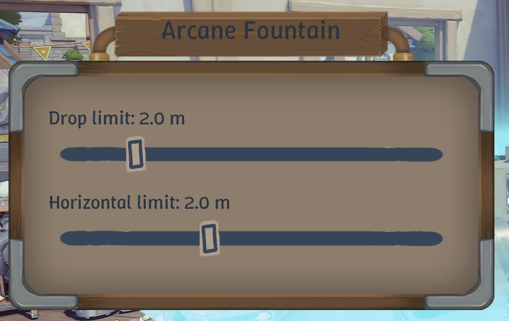

# FountainControl

Give Alchemy Factory's upright Arcane Fountains adjustable range limits, and
allow them to feed receivers near or directly below them.

Aim at a fountain and press **E** (the game's Inspect key) to open its controls.
Changes take effect immediately. FountainControl supports singleplayer;
hanging fountains and other launchers are unaffected.

## What it does


- **Drop limit:** choose how far below the fountain it can deliver, from
  **0 to 10 m** in **0.1 m** steps.
- **Horizontal limit:** choose **0 to 5 m** in **0.1 m** steps, or **Default**
  to keep the game's full horizontal reach. Use this to keep a fountain
  feeding its own production chain.
- **Remove the central exclusion:** enabled by default, allowing delivery
  into the normally unreachable region near the fountain's centre.
- **Range previews:** smaller horizontal limits shrink the existing range
  ring. Copy, move and blueprint ghosts show each fountain's configured ring.
- **Copy, move and blueprint:** moving preserves limits, copying duplicates
  them, and saved blueprints carry them.

New fountains use **10 m drop** and **Default horizontal range**. Distances are
measured from the fountain's emission point to the receiver's catch point.
With Default horizontal range, lower receivers can be reached beyond the
visible ring; the ring does not describe the entire three-dimensional range.

## Original and corrected range

The original fountain has an unreachable region around its vertical axis,
which becomes wider for receivers farther above or below the emission point.
FountainControl fills that region while retaining the original outer reach
and maximum drop. The two limit sliders can restrict that range further.


The comparison uses the default limits with `RemoveCenterExclusion = true`.
The shaded areas describe possible receiver positions; item filters and
receiver acceptance still determine whether a fountain delivers to them.

## Installation

**Install UE4SS first.** Download the standard
[UE4SS zip from the latest experimental release](https://github.com/UE4SS-RE/RE-UE4SS/releases/tag/experimental-latest)
and extract it into the game's `AlchemyFactory/Binaries/Win64` folder, beside
`AlchemyFactory-Win64-Shipping.exe`. This places `dwmapi.dll` and the `ue4ss`
folder there. With the tested build **v3.0.1-1161-g6eb3d9bc**, the default
settings work: the engine version is detected automatically, and no custom
signatures or UE4SS setting changes are needed.
The [official UE4SS installation guide](https://docs.ue4ss.com/dev/installation-guide.html)
explains the folder layout. On Linux / Proton, add
`WINEDLLOVERRIDES="dwmapi=n,b" %command%` to the game's Steam launch options.

Once UE4SS is installed:

1. Close the game and extract the FountainControl zip.
2. Copy its **FountainControl** folder into `ue4ss/Mods/`.
   The resulting folder should contain `dlls/main.dll`, `Scripts/`,
   `config.ini` and `enabled.txt`, directly inside `ue4ss/Mods/FountainControl/`.
3. Launch the game, aim at an upright fountain and press **E**.

## Updating and uninstalling

To update, close the game and replace `ue4ss/Mods/FountainControl/` with the
new version. Keep a copy of `config.ini` and restore it afterward if you have
customized it. Your per-fountain settings stay in the world's save folder.

To uninstall, close the game and remove `ue4ss/Mods/FountainControl/`.
You can keep the FountainControl subfolders in your saves for a later
reinstallation; the game ignores them and still loads normally.

## Configuration

The two distance limits are set separately for each fountain in its interface.
If you want to disable the central exclusion fix, open
`ue4ss/Mods/FountainControl/config.ini` and change this setting:

```ini
[UprightFountains]
RemoveCenterExclusion = false
```

Restart the game after changing this option. The distance sliders remain
available with either value. Change it back to `true` to fill the centre again.

## Saves and blueprints

Fountain settings are saved automatically with the next successful game save.
Each world's save folder contains a **FountainControl** subfolder with a
settings file named after each save:

```text
SaveGames/<world>/AutoSave0.sav                 ← game save
SaveGames/<world>/FountainControl/AutoSave0.sav ← fountain settings
```

**Steam Cloud syncs these settings files** along with the game saves when
cloud synchronization is enabled. The game ignores the FountainControl
subfolder. **Copy the entire world folder, including that subfolder, when
moving or backing up saves** to retain your limits.

The game's save format is unchanged, and saves still load without the mod.
A missing or invalid settings file makes fountains use the defaults. If you
save that slot while FountainControl is disabled, re-enabling it restores valid
settings for fountains that still have the same building ID (SettleKey), even
across game sessions. A changed save checksum produces a warning in
`FountainControl.log`. Fountains built or given a new ID while the mod was
disabled use the defaults.

Blueprint settings are stored **inside the blueprint PNG file**. Share the
game's exported PNG directly; image editors can remove its embedded data.
Older blueprints without FountainControl settings use the default limits.
Using a blueprint with embedded fountain limits without the mod works (uses
default limits). Workshop sharing is expected to preserve the settings based
on inspection of the upload path; an online upload/download round trip has
not been tested.

## Compatibility and troubleshooting

Version **0.1.7** was tested with **Alchemy Factory 1.0.4963 / Steam build
25321648**, Unreal Engine 5.7.4 and **UE4SS v3.0.1-1161-g6eb3d9bc**, including
Proton Experimental.

If the View prompt or controls do not appear, check the folder layout,
`enabled.txt` in the FountainControl folder, and the installed UE4SS version.
`ue4ss/UE4SS.log` and `ue4ss/Mods/FountainControl/FountainControl.log` contain
startup information. An `Unsupported game executable` message means your
game build differs from the supported one; the mod needs an update before
it can operate on that build.

For more detail, see the [validation notes](docs/validation.md),
[build instructions](docs/build.md), [native implementation](docs/native.md)
and [blueprint format](docs/blueprints.md). Contributors and future maintainers
can start with the [maintainer handoff](docs/maintaining.md).

## License

FountainControl is released under the [MIT License](LICENSE).
Third-party notices are included in `LICENSES/` and in the bundled JSON library.

## AI usage disclosure

This project was developed with substantial assistance from **OpenAI Codex**.
Codex investigated the game's native fountain behavior, wrote the mod code,
build tools and tests, ran automated and controlled in-game checks, and
prepared the documentation and range graphs.

**draradech** defined the features and compatibility requirements, made the
design decisions, supplied in-game measurements, and tested and reviewed the
interface and behavior, guiding corrections and further work.
