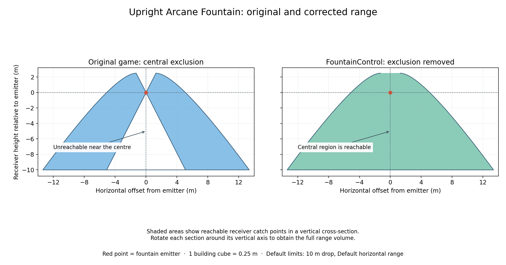

# FountainControl

Give Alchemy Factory's upright Arcane Fountains adjustable range limits, and
allow them to feed receivers near or directly below them.

Aim at a fountain and press **E** (the game's Inspect key) to open its controls.
Changes take effect immediately. FountainControl supports singleplayer;
hanging fountains and other launchers are unaffected.

## What it does

- **Drop limit:** choose how far below the fountain it can deliver, from
  **0 to 10 m** in **0.5 m** steps.
- **Horizontal limit:** choose **0 to 5 m** in **0.5 m** steps, or **Default**
  to keep the game's full horizontal reach. Use this to keep a fountain
  feeding its own production chain.
- **Remove the central exclusion:** enabled by default, allowing delivery
  into the normally unreachable region near the fountain's centre.
- **Range previews:** smaller horizontal limits shrink the existing range
  ring. Copy, move and blueprint ghosts show each fountain's configured ring.
- **Copy and share settings:** moving preserves limits, copying duplicates
  them, and saved blueprint PNGs carry them when shared, including through
  Workshop. No extra blueprint file is needed.

New fountains use **10 m drop** and **Default horizontal range**. Distances are
measured from the fountain's emission point to the receiver's catch point.
With Default horizontal range, lower receivers can be reached beyond the
visible ring; the ring does not describe the entire three-dimensional range.

## Original and corrected range

The original fountain has an unreachable region around its vertical axis,
which becomes wider for receivers farther above or below the emission point.
FountainControl fills that region while retaining the original outer reach
and maximum drop. Your two sliders can restrict that range further.



The comparison uses the default limits with `RemoveCenterExclusion = true`.
The shaded areas describe possible receiver positions; item filters and
receiver acceptance still determine whether a fountain delivers to them.

## Installation

**Install UE4SS first.** Download the standard
[UE4SS v3.0.1-946-g265115c0 zip](https://github.com/UE4SS-RE/RE-UE4SS/releases/download/experimental/UE4SS_v3.0.1-946-g265115c0.zip)
and extract it into the game's `AlchemyFactory/Binaries/Win64` folder, beside
`AlchemyFactory-Win64-Shipping.exe`. This places `dwmapi.dll` and the `ue4ss`
folder there. Alchemy Factory also needs the UE 5.7 settings and signature
fixes described in [Force Pull's UE4SS setup instructions](https://www.nexusmods.com/alchemyfactory/mods/28).
The [official UE4SS installation guide](https://docs.ue4ss.com/dev/installation-guide.html)
explains the folder layout. On Proton, add
`WINEDLLOVERRIDES="dwmapi=n,b" %command%` to the game's Steam launch options.

Once UE4SS is installed:

1. Close the game and extract the FountainControl zip.
2. Copy its **FountainControl** folder into `ue4ss/Mods/`.
   The resulting folder should contain `dlls/main.dll`, `Scripts/` and
   `config.ini`, directly inside `ue4ss/Mods/FountainControl/`.
3. Add `FountainControl : 1` to `ue4ss/Mods/mods.txt`.
4. Launch the game, aim at an upright fountain and press **E**.

Keep the DLL and Scripts folder together. If you changed the game's Inspect
binding, use that key instead of E. **Escape** closes the controls.

## Configuration

The two distance limits are set separately for each fountain in its interface.
To keep the game's central exclusion, open
`ue4ss/Mods/FountainControl/config.ini` and change this setting:

```ini
[UprightFountains]
RemoveCenterExclusion = false
```

Restart the game after changing this option. The distance sliders remain
available with either value. Change it back to `true` to fill the centre again.

## Saves and blueprints

Fountain settings are saved automatically with the next successful game save.
They live in a small file beside each save, for example
`AutoSave0.fountains.json` beside `AutoSave0.sav`. **Copy both files when moving
or backing up saves** if you want to retain your limits.

The game's save format is unchanged, and saves still load without the mod.
A missing or invalid settings file makes fountains use the defaults. Saving
that slot without FountainControl can also make its previous settings file
out of date, so re-enabling the mod may restore defaults for that slot.

Blueprint settings are stored **inside the PNG**. Share the game's exported
PNG directly; image editors can remove its embedded data. Older blueprints
without FountainControl settings use the defaults. The PNG was tested with
the mod disabled, and the Workshop upload path was checked; an online
Workshop upload/download round trip has not yet been tested.

## Compatibility and troubleshooting

Version **0.1.3** was tested with **Alchemy Factory 1.0.4963 / Steam build
25321648**, Unreal Engine 5.7.4 and **UE4SS v3.0.1-946-g265115c0**, including
Proton Experimental. It is an experimental singleplayer mod.

If the View prompt or controls do not appear, check the folder layout,
`FountainControl : 1` in `mods.txt`, and the installed UE4SS version.
`ue4ss/UE4SS.log` and `ue4ss/Mods/FountainControl/FountainControl.log` contain
startup information. An `Unsupported game executable` message means your
game build differs from the supported one; the mod needs an update before
it can operate on that build.

For more detail, see the [validation notes](docs/validation.md),
[build instructions](docs/build.md), [native implementation](docs/native.md)
and [blueprint format](docs/blueprints.md).

## AI usage disclosure

This project was developed with substantial assistance from **OpenAI Codex**.
Codex investigated the game's native fountain behavior, wrote the mod code,
build tools and tests, ran automated and controlled in-game checks, and
prepared the documentation and range graphs.

**draradech** defined the features and compatibility requirements, supplied
object dumps and in-game measurements, made the design decisions, and tested
and reviewed the interface and behavior, guiding corrections and further work.
